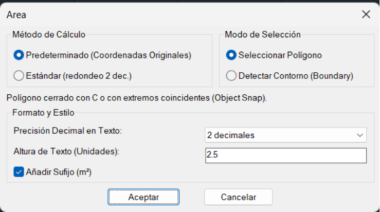
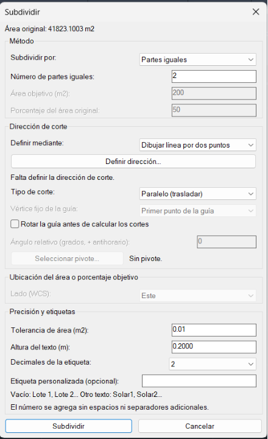
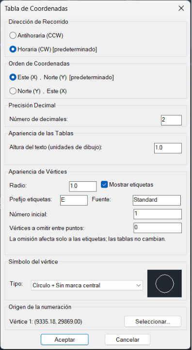
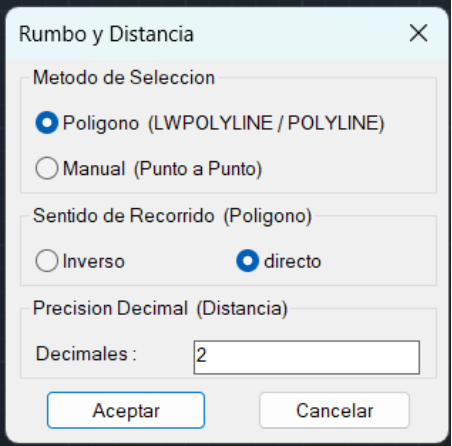
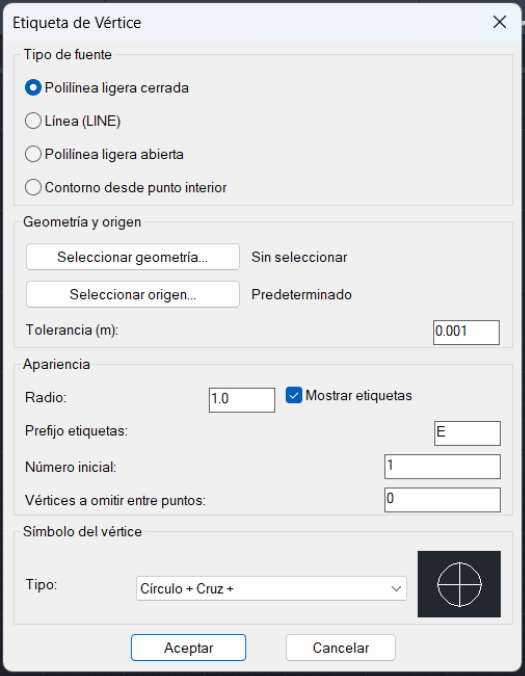
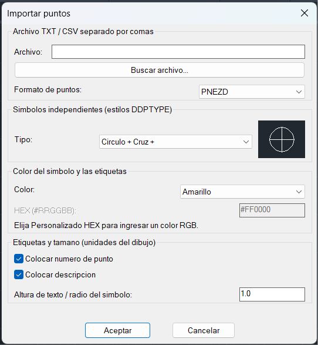
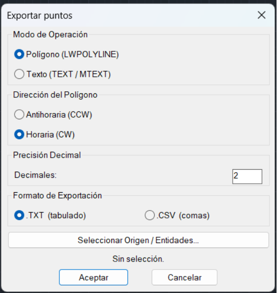
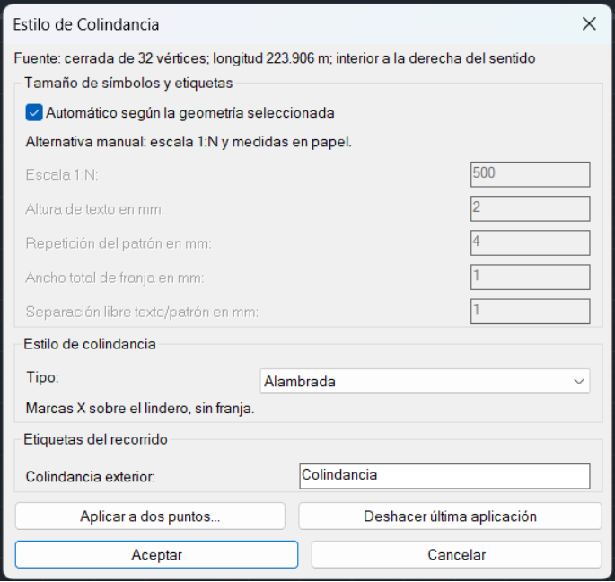
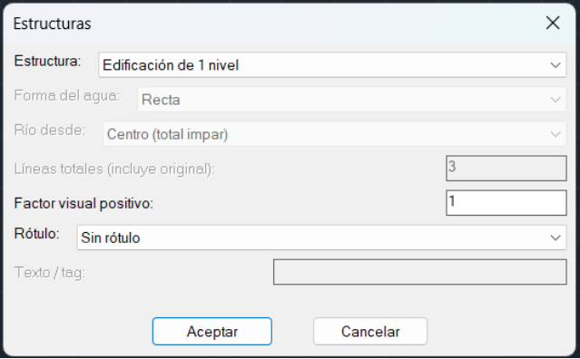

<a id="inicio"></a>

<div align="center">
  
</div>

<p align="center">
  Calcula superficies, prepara tablas de coordenadas y completa tus planos.<br>
  <strong>Herramientas para topografía y catastro, directamente en AutoCAD.</strong>
</p>

<p align="center">
  
  
  <a href="LICENSE"></a>
</p>

<p align="center">
  <strong>
    <a href="#instalacion">Instalación</a> &nbsp;·&nbsp;
    <a href="#herramientas">Herramientas</a> &nbsp;·&nbsp;
    <a href="#vista-previa">Vista previa</a> &nbsp;·&nbsp;
    <a href="#ayuda">Ayuda</a>
  </strong>
</p>

---

| 📐 Calcula y organiza | 📍 Trabaja con coordenadas | 🌿 Completa la presentación |
|---|---|---|
| Superficies, subdivisiones y tablas de rumbos y distancias. | Importación de puntos, exportación de coordenadas y etiquetas de vértices. | Linderos, edificaciones, vegetación y cuerpos de agua. |

<a id="requisitos"></a>

## Antes de instalar

- **AutoCAD para Windows de 64 bits.** No funciona en Mac, AutoCAD Web ni AutoCAD LT.
- **Windows 10 u 11.** No hace falta instalar nada más: PowerShell ya viene con Windows y no necesitas saber programar.
- **Cierra AutoCAD y guarda tus dibujos** antes de instalar, actualizar o desinstalar.
- Instalar el complemento pide permiso de administrador una sola vez. El comando `mensorcad` no lo pide.

> **Antes de trabajar:** usa una copia de tu dibujo y revisa sus unidades y sistema de coordenadas. MensorCAD no los convierte automáticamente. Para trabajar con metros y m², prepara el dibujo en metros.

<a id="instalacion"></a>

## Instalación

La instalación tiene tres pasos y se hace una sola vez. Después, para actualizar, alcanza con un comando.

<p align="center">
  <a href="https://github.com/RonGrasz/Mensor-CAD/releases/latest">Ver la última versión y sus novedades</a>
</p>

<a id="instalacion-cli"></a>

### Paso 1 · Instalar el gestor

Abre **PowerShell** (escríbelo en el menú Inicio) y pega este comando:

```powershell
irm 'https://github.com/RonGrasz/Mensor-CAD/releases/latest/download/install.ps1' -ea Stop | iex
```

Es el gestor de MensorCAD: un comando que instala, actualiza y quita el complemento por ti. **No pide permiso de administrador.** Comprueba que el enlace sea el del repositorio oficial antes de ejecutarlo: `github.com/RonGrasz/Mensor-CAD`.

Cuando termine, cierra esa ventana y abre **una nueva**: la que ya estaba abierta todavía no reconoce el comando.

<a id="instalacion-complemento"></a>

### Paso 2 · Instalar el complemento

Con AutoCAD cerrado, escribe:

```powershell
mensorcad install
```

Windows pedirá permiso de administrador: acepta el aviso. Al terminar, abre AutoCAD y tendrás el menú de MensorCAD y sus comandos.

### Paso 3 · Verificar la instalación

```powershell
mensorcad status
```

Te muestra la versión del complemento que tienes instalada. En AutoCAD, escribe `MCHELP`: si aparece la ventana de MensorCAD, ya está todo listo.

#### Comandos disponibles

| Comando | Qué hace |
|---|---|
| `mensorcad` | Muestra un resumen. No instala nada. |
| `mensorcad install` | Instala el complemento con la última versión publicada. |
| `mensorcad status` | Muestra qué versión tienes instalada. |
| `mensorcad update` | Actualiza a la última versión. |
| `mensorcad uninstall` | Quita el complemento y deja el comando listo para reinstalar. |
| `mensorcad --help` | Muestra esta lista de comandos. |
| `mensorcad --version` | Muestra la versión del comando. |

#### Si el comando no aparece

- **`mensorcad` no se reconoce.** Cierra la ventana de PowerShell y abre una nueva. Si sigue igual, vuelve a ejecutar el comando del paso 1.
- **La instalación no puede descargar el complemento.** Revisa tu conexión y vuelve a intentarlo: si algo falla, no se cambia nada de lo que ya tenías instalado.
- **¿Armaste el paquete tú mismo para probarlo?** Las guías del [bootstrap](docs/cli-bootstrap.md) y del [gestor](docs/cli-manager.md) explican la ruta local, que no usa Internet.

<a id="instalacion-manual"></a>

### Versiones anteriores · el ZIP de instalación

Hasta la versión 0.1.0, la única forma de instalar era descargar `MensorCAD-Windows.zip` y ejecutar `Instalar.bat`. Ese ZIP se sigue publicando, y su `Desinstalar.bat` sigue siendo la salida para quitar instalaciones hechas así.

<a id="instalacion-personalizada"></a>

### Alternativa · Solo las herramientas que necesitas

**Descarga los scripts y cárgalos con APPLOAD, sin instalar el paquete completo.** Esta opción no añade el menú de MensorCAD.

1. Abre la carpeta **[`lisp/`](lisp/)** y elige el archivo de la herramienta que quieras usar. Más abajo tienes la [lista de comandos y archivos](#herramientas).
2. Abre el archivo en GitHub y usa **Download raw file / Descargar archivo sin formato**. Guárdalo en una carpeta de tu equipo, conservando la extensión **`.lsp`**.
3. En AutoCAD, escribe **`APPLOAD`** y presiona Enter.
4. Busca el archivo descargado, selecciónalo y pulsa **Cargar**. Después, cierra la ventana.
5. Escribe el comando de esa herramienta en AutoCAD. Por ejemplo: carga **`MC-AREA.lsp`** y ejecuta **`MCAREA`**.

Repite la carga para cada herramienta que necesites, en el dibujo donde vas a trabajar. **No hace falta cargar todos los archivos ni seguir un orden.** Al volver a abrir AutoCAD, tendrás que cargarlos nuevamente.

<a id="herramientas"></a>

## Una herramienta para cada parte del trabajo

Con el paquete completo, abre una herramienta desde el menú o escribe su comando en AutoCAD. Si elegiste la instalación personalizada, carga primero el archivo indicado.

| Herramienta | Comando | ¿Qué puedes hacer? | Archivo para APPLOAD |
|---|---|---|---|
|  **Áreas** | `MCAREA` | Calcular y rotular la superficie de una parcela. | [MC-AREA.lsp](lisp/MC-AREA.lsp) |
|  **Tablas** | `MCTABLE` | Generar tablas de coordenadas, rumbos y distancias. | [MC-TABLE.lsp](lisp/MC-TABLE.lsp) |
|  **Rumbos y distancias** | `MCVECTOR` | Anotar los tramos de un contorno o pares de puntos. | [MC-VECTOR.lsp](lisp/MC-VECTOR.lsp) |
|  **Coordenadas** | `MCCOORD` | Colocar una tabla de coordenadas de un punto con línea de referencia. | [MC-COORD.lsp](lisp/MC-COORD.lsp) |
|  **Vértices** | `MCVERTEX` | Marcar y numerar los vértices de un contorno. | [MC-VERTEX.lsp](lisp/MC-VERTEX.lsp) |
|  **Subdivisión** | `MCSUBDIV` | Dividir una parcela por superficie, porcentaje o partes iguales. | [MC-SUBDIV.lsp](lisp/MC-SUBDIV.lsp) |
|  **Escala por superficie** | `MCTRANSFORM` | Crear una copia de un contorno con el área que necesitas. | [MC-TRANSFORM.lsp](lisp/MC-TRANSFORM.lsp) |
|  **Importar puntos** | `MCIMPORT` | Llevar puntos de un archivo TXT o CSV al dibujo. | [MC-IMPORT.lsp](lisp/MC-IMPORT.lsp) |
|  **Exportar coordenadas** | `MCEXPORTEX` | Guardar coordenadas de vértices o posiciones de textos en TXT o CSV. | [MC-EXPORTEX.lsp](lisp/MC-EXPORTEX.lsp) |
|  **Preparar polilíneas** | `MCFIX` | Convertir polilíneas antiguas compatibles para trabajar con ellas. | [MC-FIX.lsp](lisp/MC-FIX.lsp) |
|  **Colindancias** | `MCCOLIND` | Representar linderos y colocar nombres de colindantes. | [MC-COLIND.lsp](lisp/MC-COLIND.lsp) |
|  **Elementos del terreno** | `MCELEMENTS` | Dibujar edificaciones, vegetación, masas de agua y ríos. | [MC-ELEMENTS.lsp](lisp/MC-ELEMENTS.lsp) |
| **Acerca de MensorCAD** | `MCHELP` | Consultar la versión y abrir la página del proyecto. | [MC-HELP.lsp](lisp/MC-HELP.lsp) |

<a id="vista-previa"></a>

## Mira las herramientas por dentro

Consulta las opciones de cada herramienta. Puedes plegar las secciones si lo prefieres.

<details open>
<summary><strong>📐 Superficies y subdivisión de parcelas</strong></summary>

### Cálculo de áreas

Elige el formato del área, los decimales y el tamaño del texto.

**Cierre del polígono.** Puedes seleccionar una `LWPOLYLINE` cerrada con `Cerrar (C)` o cerrada manualmente haciendo coincidir el último vértice con el primero mediante Object Snap. El cierre manual requiere al menos tres vértices más el punto final repetido; se admite una diferencia máxima de `0.00000001` unidades de dibujo entre los extremos para absorber ruido numérico. No se modifica la polilínea original ni se cierran contornos con extremos separados por encima de esa tolerancia. Funciona en los dos métodos de cálculo.



### Subdivisión

Configura cortes paralelos o en abanico y define cómo repartir la superficie.

**Etiqueta personalizada (opcional).** En «Precisión y etiquetas» podés cambiar el nombre de los lotes. Si dejás el campo vacío, se mantiene `Lote 1`, `Lote 2`… Si escribís un texto, la secuencia desde `1` se agrega directamente, sin espacios ni separadores adicionales; el área sigue apareciendo debajo.

| Texto ingresado | Rótulos generados |
| --- | --- |
| Vacío | `Lote 1`, `Lote 2`, `Lote 3`… |
| `Solar` | `Solar1`, `Solar2`, `Solar3`… |
| `6622026107043_1_` | `6622026107043_1_1`, `6622026107043_1_2`, `6622026107043_1_3`… |



</details>

<details open>
<summary><strong>📍 Tablas, rumbos y vértices</strong></summary>

### Tablas de coordenadas

Ajusta el orden de las coordenadas, el recorrido y las etiquetas de los vértices; además eliges la altura del texto de las tablas en el propio cuadro de diálogo. Las tablas nuevas calculan sus anchos según los títulos, encabezados y datos, con márgenes y alturas proporcionales para evitar cortes de palabras y filas amontonadas.

**Altura del texto.** El campo «Altura del texto (unidades de dibujo)» fija el tamaño de las dos tablas; el valor predeterminado es `1.0` y no depende de `TEXTSIZE` ni del estilo de texto del dibujo. Se aceptan decimales mayores que cero: un valor vacío, negativo, cero o mal escrito se rechaza con un aviso en el mismo cuadro. Las dos tablas calculan su ancho con el mismo criterio compacto: el ancho medido de títulos, encabezados y datos más márgenes horizontales de `0.5` alturas de texto a cada lado de las celdas, sin porcentaje extra sobre el texto medido. La columna de estaciones conserva además un mínimo de cuatro alturas de texto para que el encabezado `EST` se vea en una sola línea en las dos tablas, y los rótulos de estación en negrita mantienen una holgura mínima para no recortarse; ese mínimo es solo un piso, así que más vértices o números de estación más largos siguen ampliando la columna. Si el título requiere espacio adicional, se reparte por igual entre las dos columnas de datos, sin ensanchar la columna de estaciones. Cuando se dibujan las dos tablas, el comando iguala su tamaño final: la más angosta se amplía, sin quedar por debajo de lo medido, hasta el ancho total de la otra repartiendo el espacio extra entre sus columnas de datos, y cada fila toma la altura mayor de las dos, así que las dos tablas ocupan lo mismo sin recortar texto ni reducir la altura de la fuente. Si se omite el punto de la tabla de rumbos, la tabla de coordenadas se dibuja sola con su propio ancho. La cantidad de vértices añade filas sin reducir el texto ni los márgenes.

**Fuente privada.** Las tablas usan un estilo de texto propio, `MCTABLE-TABLAS`, con la fuente Arial (`arial.ttf`), altura fija 0, ancho 1 y sin oblicuidad. Antes de dibujar, el comando busca Arial en las rutas de búsqueda de AutoCAD y, si no la encuentra ahí, en la carpeta `Fonts` de Windows; cuando Arial no está disponible usa la fuente estándar de AutoCAD `txt.shx` (o `simplex.shx` si tampoco existe) y lo avisa en la línea de comandos. Si no localiza ninguna de ellas, muestra un error y aborta sin crear el estilo ni dibujar tablas, en lugar de dibujar con una fuente sustituida desconocida. El estilo se crea con el nombre de fuente sin ruta; si `MCTABLE-TABLAS` ya existe con otra fuente u otra definición se crea una variante con sufijo en vez de redefinirlo, y si la creación falla el comando aborta con el mismo aviso. Se mantienen la altura elegida, los márgenes proporcionales y los anchos dinámicos en las dos tablas. El estilo se aplica solo a las tablas nuevas: no cambia el estilo de texto actual ni el estilo de tabla del dibujo, ni modifica las tablas ya creadas. Para probar una actualización del script, vuelve a cargar `MC-TABLE.lsp` con `APPLOAD` y genera tablas nuevas con `MCTABLE`.

**Símbolos y numeración.** El bloque «Apariencia de Vértices» incorpora las mismas opciones que MCVERTEX, aplicadas de forma independiente en MCTABLE (no necesita cargar `MC-VERTEX.lsp`): «Radio», «Mostrar etiquetas», «Prefijo etiquetas», «Número inicial», «Vértices a omitir entre puntos» y la lista «Símbolo del vértice» con su vista previa y el campo «Fuente» de las etiquetas.

| Opción | Predeterminado | Efecto |
| --- | --- | --- |
| Radio | `1.0` | Tamaño del símbolo y de la etiqueta; se exige un número positivo. |
| Mostrar etiquetas | Activado | Sin etiquetas se mantienen los símbolos y las tablas completas. |
| Prefijo etiquetas | `E` | Prefijo del texto `E-<estación>`. |
| Número inicial | `1` | Primera estación de las etiquetas y de la columna EST de las dos tablas; entero entre 1 y 2147483647. |
| Vértices a omitir entre puntos | `0` | Solo filtra etiquetas: con 5 o más vértices deja `omitir` vértices sin etiqueta entre dos etiquetas. |
| Símbolo del vértice | Círculo sin marca central | Símbolo en todos los vértices, con la misma lista de 20 estilos y la misma vista previa que MCVERTEX. |

**Numeración y omisión.** Las etiquetas y las dos tablas comparten la numeración: con siete vértices, inicio `5` y omisión `2` se dibujan siete símbolos, las etiquetas `E-5`, `E-8` y `E-11`, y las filas EST de ambas tablas van de `5` a `11`. Las filas de las tablas nunca se omiten y los símbolos se dibujan en todos los vértices, aunque la omisión o «Mostrar etiquetas» dejen vértices sin texto. El estilo «sin marca central» no dibuja ningún símbolo y se rechaza si las etiquetas están desactivadas. Las etiquetas siguen evitando los símbolos de los vértices sin etiqueta y los bordes del polígono.

**Validación y dibujo.** El radio debe ser positivo y el número inicial y la omisión deben ser enteros decimales estrictos (mismo criterio que MCVERTEX: no se acepta texto sobrante ni decimales). Si un valor no sirve, el cuadro sigue abierto con el aviso y el foco en el campo; las entradas escritas, incluidas las inválidas, se conservan al reabrir el cuadro para elegir el origen. Como todas las filas de las tablas llevan estación, la numeración se valida con el último vértice completo antes de crear etiquetas o tablas: `inicio` más el último índice no puede superar 2147483647. Los símbolos y las etiquetas solo se dibujan en polilíneas horizontales con normal `+Z`; en otros casos las tablas se construyen igual. La fuente elegida en «Fuente» se usa para medir y dibujar las etiquetas sin cambiar el estilo de texto del dibujo.



### Rumbos y distancias

Elige entre recorrer un contorno o indicar pares de puntos manualmente.



### Símbolos de vértices

Elige el símbolo, su tamaño y la numeración que vas a usar.

**Omisión de etiquetas.** «Vértices a omitir entre puntos» afecta solo a las etiquetas: el símbolo elegido se genera en todos los vértices conservados tras aplicar la tolerancia, incluso con «Mostrar etiquetas» desactivado. La omisión se aplica desde cinco vértices conservados; con omisión `2` e inicio `1`, las etiquetas son `E-1`, `E-4`, `E-7…`, sin renumerar los demás vértices. Las etiquetas también evitan los símbolos de los vértices sin etiqueta.



</details>

<details open>
<summary><strong>📂 Importación y exportación de puntos</strong></summary>

### Importar puntos

Selecciona el archivo, el orden de las coordenadas y la apariencia de los puntos.



### Exportar coordenadas

Elige los objetos de origen y guarda sus coordenadas en un archivo.



</details>

<details open>
<summary><strong>🌿 Colindancias y elementos del terreno</strong></summary>

### Colindancias

Elige el estilo de lindero y el nombre de la colindancia.



### Elementos del terreno

Agrega edificaciones, áreas verdes y agua con sus opciones de presentación.



</details>

<a id="ayuda"></a>

## Ayuda rápida

| Si te pasa esto… | Prueba lo siguiente |
|---|---|
| AutoCAD dice «Comando desconocido». | Si usaste APPLOAD, carga el archivo correspondiente en ese dibujo. Si instalaste el paquete, cierra y vuelve a abrir AutoCAD. |
| El instalador pide cerrar AutoCAD. | Guarda tus dibujos, cierra todas las ventanas de AutoCAD y ejecuta nuevamente el instalador. |
| `mensorcad` no se reconoce como comando. | Cierra la ventana de PowerShell y abre una nueva. Si sigue igual, vuelve a ejecutar el comando del paso 1. |
| `mensorcad install` no puede descargar el paquete. | Revisa tu conexión y vuelve a intentarlo desde la [página de descargas](https://github.com/RonGrasz/Mensor-CAD/releases/latest). Si la descarga o la verificación fallan, no se modifica nada de lo que ya tenías instalado. |
| Una herramienta no acepta el contorno. | Revisa los mensajes de AutoCAD. Algunas herramientas necesitan una polilínea cerrada, plana y sin cruces. |

**¿Necesitas reportar un problema?** Cuéntanos qué comando usaste, tu versión de AutoCAD y qué ocurrió en **[Problemas y consultas](https://github.com/RonGrasz/Mensor-CAD/issues)**. Una captura del mensaje ayuda.

<a id="actualizacion"></a>

## Actualizar

Con AutoCAD cerrado, escribe:

```powershell
mensorcad update
```

Compara la versión que tienes con la última publicada: si ya estás al día, informa «Ya estás actualizado» y no toca nada; si hay una versión nueva, la instala. Nunca vuelve a una versión anterior.

Si instalaste con el ZIP de una versión anterior, puedes descargar el ZIP nuevo y ejecutar `Instalar.bat` como antes, sin desinstalar primero.

Si cargaste las herramientas con APPLOAD, reemplaza los archivos por los nuevos y vuelve a cargarlos después de reiniciar AutoCAD.

<a id="desinstalacion"></a>

## Desinstalar

Cierra AutoCAD y ejecuta:

```powershell
mensorcad uninstall
```

Quita el complemento y no necesita Internet. El comando `mensorcad` queda instalado, así que puedes volver a instalar MensorCAD cuando quieras.

Si instalaste con el ZIP de una versión anterior, descarga ese ZIP y haz doble clic en `Desinstalar.bat`, en la carpeta donde lo extrajiste.

Las tablas, textos y símbolos que ya creaste **permanecen en tus dibujos**. Las funciones automáticas que dependan de una herramienta dejarán de ejecutarse si no está instalada o cargada.

---

<p align="center">
  <strong>MensorCAD™ · Topografía y catastro en AutoCAD</strong><br>
  Distribuido bajo la <a href="LICENSE">licencia MIT</a>.<br><br>
  <a href="#inicio">↑ Volver al inicio</a>
</p>
