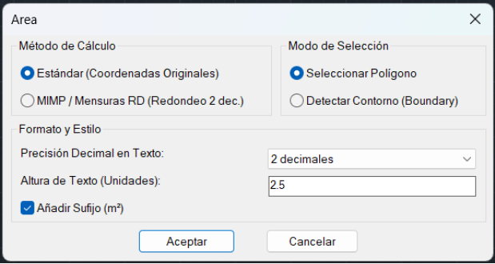
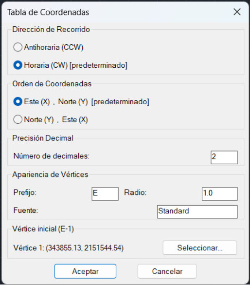
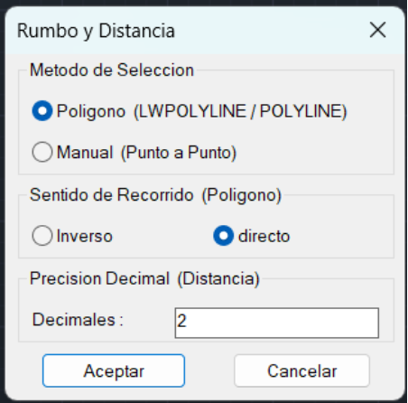
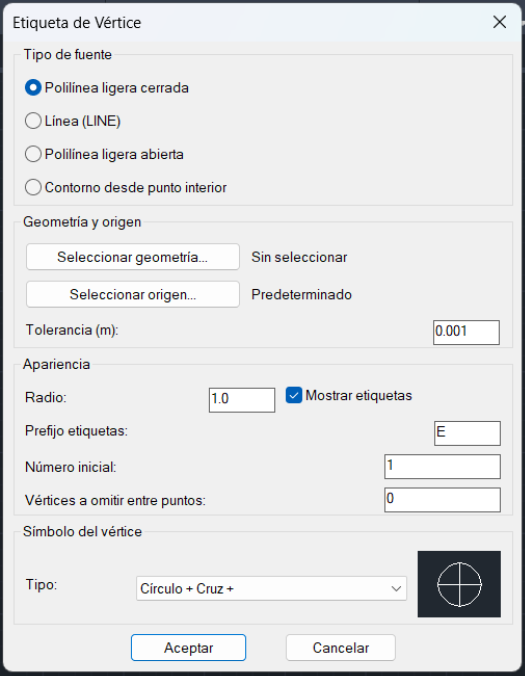
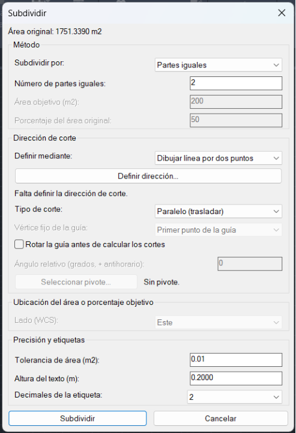
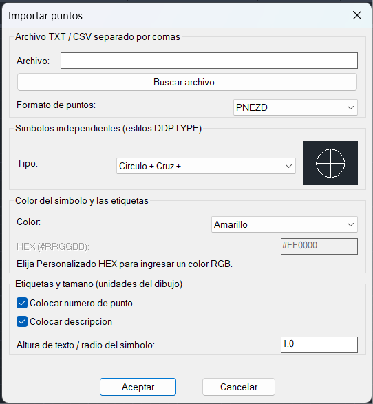
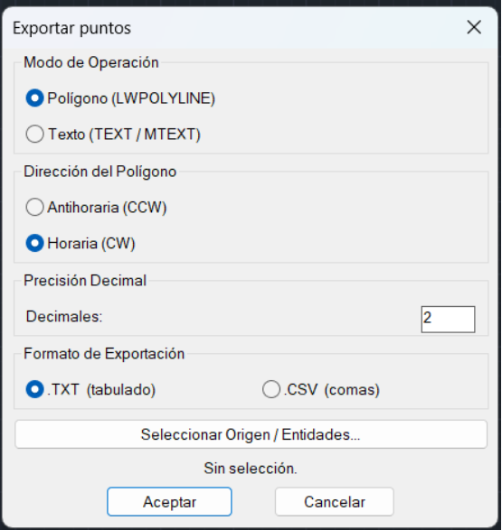
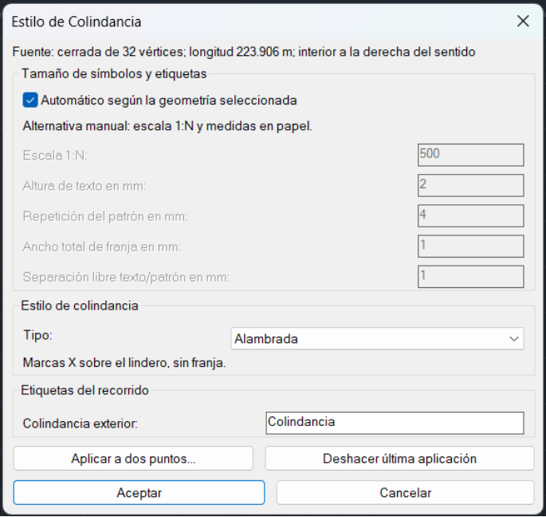
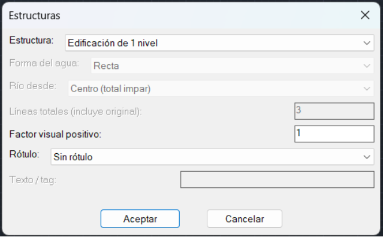

# MensorCAD™

Herramientas LISP para agilizar el trabajo topográfico y catastral en AutoCAD: calcula superficies, genera tablas de coordenadas, anota planos, subdivide parcelas e importa o exporta puntos. Cada comando se carga de forma independiente, y la mayoría ofrece un cuadro de opciones para configurar el resultado.

[Instalación](#instalación) · [Comandos](#comandos) · [Desinstalación](#desinstalación)

## Plataformas y requisitos

- **AutoCAD para Windows de 64 bits**, con soporte AutoLISP y ActiveX/VLA.
- Los archivos `.lsp` de la carpeta [`lisp/`](lisp/).
- Para estructuras y operaciones con superficies, disponibilidad de las funciones nativas REGION, operaciones booleanas y Offset utilizadas por cada herramienta.

No se garantiza compatibilidad con AutoCAD para Mac, AutoCAD Web, AutoCAD LT ni una versión mínima concreta de AutoCAD. Las funciones de curvas y agua ondulada dependen de las capacidades de la versión instalada.

> **Antes de comenzar:** trabaja sobre una copia de tu dibujo. MensorCAD no transforma sistemas de coordenadas ni convierte unidades. Las herramientas que expresan distancias y áreas en metros requieren un dibujo preparado en metros; `MCTRANSFORM` utiliza unidades de dibujo al cuadrado.

## Instalación

La carga es **manual mediante `APPLOAD`**, igual para todos los comandos:

1. Guarda en tu equipo los archivos de la carpeta `lisp/`.
2. En AutoCAD, escribe `APPLOAD` y presiona Enter.
3. Busca el archivo `.lsp` de la herramienta que quieras usar, selecciónalo y pulsa **Cargar**. Después, cierra la ventana.
4. Escribe el comando correspondiente en la línea de comandos. Por ejemplo, carga `MC-AREA.lsp` y ejecuta `MCAREA`.

Repite estos pasos para las herramientas que necesites en el dibujo donde vas a trabajar. No hace falta cargar todos los scripts ni seguir un orden específico.

## Comandos

### Resumen de herramientas

| Comando | ¿Para qué sirve? | Archivo que debes cargar |
|---|---|---|
| [MCAREA](#mcarea--áreas-catastrales) | Calcular y rotular superficies | `MC-AREA.lsp` |
| [MCTABLE](#mctable--tablas-de-coordenadas-rumbos-y-distancias) | Crear tablas y numerar vértices | `MC-TABLE.lsp` |
| [MCVECTOR](#mcvector--rumbos-y-distancias-sobre-el-plano) | Anotar los tramos de una polilínea o pares de puntos | `MC-VECTOR.lsp` |
| [MCCOORD](#mccoord--coordenadas-de-un-punto) | Insertar una tabla de coordenadas con línea de referencia | `MC-COORD.lsp` |
| [MCVERTEX](#mcvertex--símbolos-y-etiquetas-de-vértices) | Marcar y numerar vértices | `MC-VERTEX.lsp` |
| [MCSUBDIV](#mcsubdiv--subdivisión-por-superficie) | Dividir parcelas por área, porcentaje o partes iguales | `MC-SUBDIV.lsp` |
| [MCTRANSFORM](#mctransform--escala-por-superficie) | Crear una copia de un contorno con otra superficie | `MC-TRANSFORM.lsp` |
| [MCIMPORT](#mcimport--importar-puntos) | Dibujar puntos y etiquetas desde TXT o CSV | `MC-IMPORT.lsp` |
| [MCEXPORTEX](#mcexportex--exportar-coordenadas) | Exportar coordenadas de vértices o inserciones de texto | `MC-EXPORTEX.lsp` |
| [MCFIX](#mcfix--normalizar-polilíneas) | Convertir polilíneas antiguas compatibles a ligeras | `MC-FIX.lsp` |
| [MCCOLIND](#mccolind--simbología-de-colindancias) | Representar linderos y nombrar colindancias | `MC-COLIND.lsp` |
| [MCELEMENTS](#mcelements--estructuras-y-elementos-del-terreno) | Dibujar edificaciones, vegetación y agua | `MC-ELEMENTS.lsp` |
| [MCHELP](#mchelp--acerca-de-mensorcad) | Consultar información de MensorCAD y abrir su repositorio | `MC-HELP.lsp` |

### MCAREA — Áreas catastrales

Calcula la superficie de una polilínea cerrada y coloca su valor en el centroide del polígono.

**Uso:** ejecuta `MCAREA`, configura el formato y selecciona la polilínea o indica un punto interior para detectar su contorno.

**Opciones:** método estándar con las coordenadas originales, o **MIMP / Mensuras RD**, que redondea las coordenadas a dos decimales antes del cálculo; precisión de 0 a 4 decimales, altura de texto y sufijo `m²` opcional.



### MCTABLE — Tablas de coordenadas, rumbos y distancias

Genera una tabla de coordenadas Este/Norte y otra de rumbos y distancias a partir de una polilínea cerrada. También dibuja círculos y etiquetas en sus vértices.

**Uso:** ejecuta `MCTABLE`, elige el contorno y el vértice de origen, configura las tablas e indica dónde colocarlas.

**Opciones:** orden de columnas X/Y, precisión decimal, recorrido horario —predeterminado— o antihorario, prefijo, radio y fuente de las etiquetas. Los rumbos se expresan como `N DD° MM' SS" E`.

Las etiquetas se colocan por fuera del contorno. Si una no cabe, se omite con un aviso y se conserva su círculo. Las anotaciones requieren una polilínea horizontal con normal `+Z`; con arcos, la colocación se comprueba respecto de las cuerdas, no de la curva real.



### MCVECTOR — Rumbos y distancias sobre el plano

Anota el rumbo y la distancia de cada tramo con textos orientados para facilitar su lectura.

**Uso:** ejecuta `MCVECTOR` y elige **Polígono**, para recorrer una polilínea desde un vértice de inicio, o **Manual**, para indicar pares de puntos hasta terminar con Esc.

**Opciones:** sentido de recorrido directo o inverso y precisión de la distancia de 0 a 8 decimales.



### MCCOORD — Coordenadas de un punto

Inserta una tabla con Este, Norte y Altura, a tres decimales, y una línea que la conecta con el punto elegido.

**Uso:** ejecuta `MCCOORD`, indica un punto, nodo o vértice y luego la ubicación de la tabla.

Al desplazar la tabla con `MOVE` o pinzamientos, la línea se reajusta al terminar el comando, no durante el arrastre. Las coordenadas corresponden al punto elegido originalmente: editar después la geometría de origen no las recalcula. La reasociación al copiar, rotar o escalar la tabla no está garantizada.

> El título de la tabla es `COORDENADAS UTM 19 NORTE`, pero los valores se toman en WCS: el dibujo ya debe estar en el sistema de coordenadas correcto.

### MCVERTEX — Símbolos y etiquetas de vértices

Marca vértices con símbolos locales y etiquetas opcionales como `E-1`. Admite líneas horizontales, polilíneas ligeras abiertas o cerradas y contornos detectados desde un punto interior.

**Uso:** ejecuta `MCVERTEX`, selecciona la geometría, elige el origen y ajusta la apariencia. Los contornos cerrados se recorren en sentido horario; en fuentes abiertas, el origen es el extremo más cercano al clic.

**Opciones:** 20 símbolos con previsualización, radio, prefijo, etiquetas activadas o desactivadas, número inicial positivo, tolerancia de fusión y cantidad de vértices a omitir entre puntos.

- La tolerancia inicial es `0.001 m`: fusiona anotaciones de vértices adyacentes próximos, sin mover la fuente ni fusionar vértices no adyacentes.
- La omisión se aplica desde cinco vértices conservados. Con omisión `2` e inicio `1`, las etiquetas son `E-1`, `E-4`, `E-7…`: los vértices omitidos no renumeran los demás.
- Las etiquetas que no encuentran espacio se omiten con un aviso. El símbolo invisible requiere etiquetas activas.

Los símbolos no son puntos COGO ni entidades POINT y no cambian `PDMODE` ni `PDSIZE`. Se usa la capa y el estilo de texto actuales. Solo se admite geometría horizontal con normal `+Z`; los arcos se consideran por sus cuerdas para colocar etiquetas, por lo que conviene revisar el resultado en contornos curvos.



### MCSUBDIV — Subdivisión por superficie

Divide una parcela mediante cortes **paralelos** o **anclados en abanico**, conservando la polilínea original.

**Uso:** ejecuta `MCSUBDIV`, selecciona el contorno, elige el método, define una guía mediante dos puntos o vértices y pulsa **Subdividir**.

| Opción | Resultado |
|---|---|
| Partes iguales | La cantidad indicada de parcelas con igual superficie |
| Área + resto | Una parcela con el área solicitada y otra con el resto |
| Porcentaje + resto | Una parcela con el porcentaje solicitado y otra con el resto |
| Paralelo | Cortes que conservan la dirección de la guía; permite rotarla con ángulo y pivote |
| Anclado | Cortes que comparten un vértice real del contorno como ancla |

También permite elegir el lado objetivo, tolerancia de área —inicialmente `0.01 m²`—, altura y decimales de las etiquetas. Los lados Norte/Sur/Este/Oeste se interpretan respecto de WCS. Los decimales de las etiquetas no cambian la precisión de los cortes.

Genera contornos cerrados, líneas divisorias y etiquetas. Una fuente abierta se cierra solo en una copia de trabajo, que también se conserva como resultado. Solo admite polilíneas ligeras simples, horizontales, con normal `+Z`, tramos rectos y sin huecos. Rechaza divisiones que produzcan parcelas desconectadas; si un ancla no permite resolver el abanico, prueba otro vértice o el modo paralelo. Un `UNDO` retira los resultados de la ejecución.



### MCTRANSFORM — Escala por superficie

Crea una copia cerrada verde de un contorno y la amplía o reduce hasta el área indicada, manteniendo su forma y el centroide de su superficie.

**Uso:** ejecuta `MCTRANSFORM`, selecciona una polilínea ligera e introduce un área objetivo positiva. Enter o Esc cancela y retira la copia.

El área se expresa en **unidades de dibujo al cuadrado**: si trabajas en metros, corresponde a m². Por ejemplo, un contorno de `100 m²` reducido a `25 m²` tendrá sus longitudes a la mitad.

Admite fuentes abiertas o cerradas, simples, horizontales, con normal `+Z` y sin arcos. Las abiertas se cierran únicamente en la copia. La fuente permanece intacta; el resultado usa la capa actual y no copia etiquetas ni asociaciones. Un `UNDO` retira la copia.

### MCIMPORT — Importar puntos

Importa coordenadas desde archivos TXT o CSV y crea símbolos con número y descripción opcionales, agrupados por punto.

**Uso:** ejecuta `MCIMPORT`, busca el archivo, selecciona el orden de columnas y configura símbolo, tamaño, color y etiquetas. Al importar se ajusta la vista a los resultados.

**Opciones:** 20 símbolos con previsualización; tamaño común para símbolo y texto; colores ACI, Por capa o RGB personalizado en formato HEX, como `#FF8000`; número y descripción independientes.

#### Preparar el archivo

Usa **comas como separador**, punto decimal y un punto por línea, también si la extensión es `.txt`. No se admiten separadores de tabulación ni punto y coma.

`E = X` · `N = Y` · `Z = altura` · `P = identificador` · `D = descripción`.

- Formatos: `EN`, `NE`, `ENZ`, `NEZ`, `PEN`, `PNE`, `PENZ`, `PNEZ`, `END`, `NED`, `ENZD`, `NEZD`, `PEND`, `PNED`, `PENZD` y **`PNEZD` —predeterminado—**.
- Si falta Z se usa `0`; si falta P se numera desde `1`. Los identificadores conservan sus ceros iniciales.
- La cabecera es opcional y debe coincidir con las letras del formato elegido. Las descripciones con comas deben ir entre comillas.

Ejemplo en formato **PNEZD**:

```csv
P,N,E,Z,D
1,2151544.225,343872.683,346.931,alambrada
2,2151550.000,343880.000,347.000,"poste, lado norte"
```

El primer punto tendrá X `343872.683`, Y `2151544.225` y Z `346.931`. Se conservan las coordenadas WCS, sin transformación geodésica.

El archivo completo se valida antes de dibujar. Los símbolos no son POINT ni objetos COGO; las etiquetas son textos editables en la capa y estilo actuales. Para seleccionar cada grupo completo, usa `PICKSTYLE = 1` o `3`; `Ctrl+H` alterna la selección de grupos. Un `UNDO` retira la importación.



### MCEXPORTEX — Exportar coordenadas

Exporta coordenadas XY de los vértices de una `LWPOLYLINE` o de los puntos de inserción de entidades `TEXT` y `MTEXT`. **No interpreta el contenido escrito en los textos ni exporta alturas Z.**

**Uso:** ejecuta `MCEXPORTEX`, elige **Polígono** o **Texto**, pulsa **Seleccionar Origen / Entidades...**, configura la salida y acepta para elegir dónde guardar el archivo.

**Opciones:** recorrido horario o antihorario en modo polígono, vértice de origen, precisión de 0 a 8 decimales y formato TXT o CSV. En modo texto, los puntos se ordenan de mayor a menor Y.

| Formato | Separador | Orden de cada registro |
|---|---|---|
| TXT | Tabulación | Número, X, Y; incluye cabecera de coordenadas |
| CSV | Coma | Número, Y, X; sin cabecera |

> **Revisa el orden de columnas:** el CSV corresponde al orden `PNE` de `MCIMPORT`; el TXT tabulado no se puede importar directamente con esa herramienta. La extracción no convierte entre OCS, UCS y WCS: comprueba las coordenadas antes de utilizar el archivo, especialmente con un UCS rotado o fuentes fuera del plano XY mundial.



### MCFIX — Normalizar polilíneas

Convierte polilíneas antiguas 2D y polilíneas 3D horizontales compatibles a polilíneas ligeras (`LWPOLYLINE`). Las que ya son ligeras no se modifican.

**Uso:** ejecuta `MCFIX` y elige **Seleccion**, para procesar entidades concretas, **Todo**, para recorrer el espacio actual, o **Ayuda**, para consultar los límites.

**Opción visual:** **Configurar puntos → Si** aplica `PDMODE=32` y `PDSIZE=1` a **todos los POINT del dibujo**. Está desactivada por defecto; elige **No** para conservar su apariencia.

No aplana alturas, no cierra contornos ni elimina vértices o autointersecciones. Las polilíneas 3D deben tener exactamente la misma Z en todos sus vértices. Se omiten, entre otras, fuentes en capas bloqueadas, mallas y entidades con asociaciones que no puedan conservarse con seguridad.

La conversión reemplaza la entidad por otra con un identificador nuevo. Consulta el resumen de convertidas, compatibles, omitidas y fallidas; un `UNDO` permite recuperar las fuentes de una ejecución con cambios.

### MCCOLIND — Simbología de colindancias

Aplica un patrón a un tramo de una línea o polilínea y añade dos etiquetas: el tipo de lindero en el interior y el nombre de la colindancia en el exterior, sin modificar la fuente.

**Uso:** ejecuta `MCCOLIND`, selecciona la geometría y, si está abierta, señala el lado interior. Elige el estilo y el nombre exterior; pulsa **Aplicar a dos puntos...** para delimitar el tramo. Confirma la vista previa con Enter o Espacio; en fuentes cerradas, `I` invierte el recorrido.

**Estilos:** Alambrada, Lindero, Pared propia, Pared medianera, Pared colindante, Malla ciclónica y Lindero de árboles vivos.

**Opciones:** tamaño automático según la geometría completa o medidas manuales de papel —escala `1:N`, altura de texto, repetición, ancho de franja y separación—. El modo manual supone que el dibujo está en metros.

Puedes aplicar varios tramos, **Deshacer última aplicación** y **Aceptar** para conservarlos. **Cancelar o Esc descarta toda la ejecución**, incluidas las aplicaciones anteriores de esa sesión. Si las etiquetas no caben automáticamente, se solicita una ubicación manual; si no existe una ubicación válida, se descarta la ejecución.

Solo admite líneas y polilíneas ligeras horizontales, con normal `+Z` y tramos rectos, sin cruces ni superposiciones. El patrón de cada aplicación se agrupa; las etiquetas quedan separadas para editarlas. Usa `PICKSTYLE = 1` o `3` para seleccionar el patrón completo. El resultado es estático: editar la fuente no lo actualiza. Un `UNDO` retira una ejecución aceptada.



### MCELEMENTS — Estructuras y elementos del terreno

Dibuja edificaciones de uno o dos niveles, una edificación octagonal, áreas verdes, masas de agua y ríos, sin seleccionar ni modificar objetos anteriores.

**Uso:** ejecuta `MCELEMENTS`, elige la estructura y sus opciones y marca los puntos. En polígonos, Enter cierra el contorno; en ríos, termina el recorrido abierto. Para el octágono se indica centro y radio.

**Opciones principales:**

- **Factor visual positivo:** ajusta trama y rótulo, no el tamaño del contorno ni la separación del agua.
- **Rótulo:** ninguno, texto o círculo con tag para polígonos; ninguno o texto paralelo para ríos. Si un rótulo interior no cabe, puede reubicarse o reducirse; si no se encuentra sitio, se cancela la ejecución.
- **Agua recta u ondulada:** la forma ondulada es una curva suavizada y puede apartarse de los puntos indicados.
- **Ríos por centro o límite:** el total de líneas incluye la original. En centro debe ser impar; en límite se indica el lado de las copias. La separación ondulada es aproximada y puede reducirse para evitar cruces.

Edificaciones y vegetación producen contorno y trama; el agua utiliza curvas. Cada estructura usa su propia capa, y los resultados son estáticos y editables: modificar el contorno no recalcula el patrón ni los rótulos.

> **Agua y geometrías complejas:** las operaciones dependen del motor REGION/Offset de AutoCAD. El agua ondulada requiere funciones de SPLINE compatibles; una región aceptada no garantiza que conserve todo el recorrido de una curva compleja. Si aparece **«relleno completo NO certificado»**, revisa el contorno final y sus desfases antes de utilizar el resultado. Los ríos ondulados muy cerrados o en U pueden rechazarse; prueba un recorrido más simple o la forma recta.



### MCHELP — Acerca de MensorCAD

Ejecuta `MCHELP` para consultar una descripción de la herramienta, su versión, autor y repositorio.

**Abrir repositorio** intenta abrir GitHub en el navegador; requiere conexión para consultar la página. **Cerrar**, Esc o la X cierran el cuadro sin abrir el navegador. No modifica el dibujo.

## Desinstalación

La carga manual con `APPLOAD` no instala un paquete ni dispone de un botón para descargar los comandos LISP ya cargados.

Para dejar de usarlos, guarda tus dibujos y **cierra por completo AutoCAD**. Al abrirlo de nuevo, no vuelvas a cargar los archivos con `APPLOAD`. Si ya no los necesitas, puedes eliminar de tu equipo las copias de los archivos `.lsp`.

Esto **no borra las tablas, textos, símbolos ni demás entidades creadas en los dibujos**. Las actualizaciones que dependen de un script dejan de ejecutarse mientras no esté cargado.

## Licencia

MensorCAD se distribuye bajo la [licencia MIT](LICENSE).
